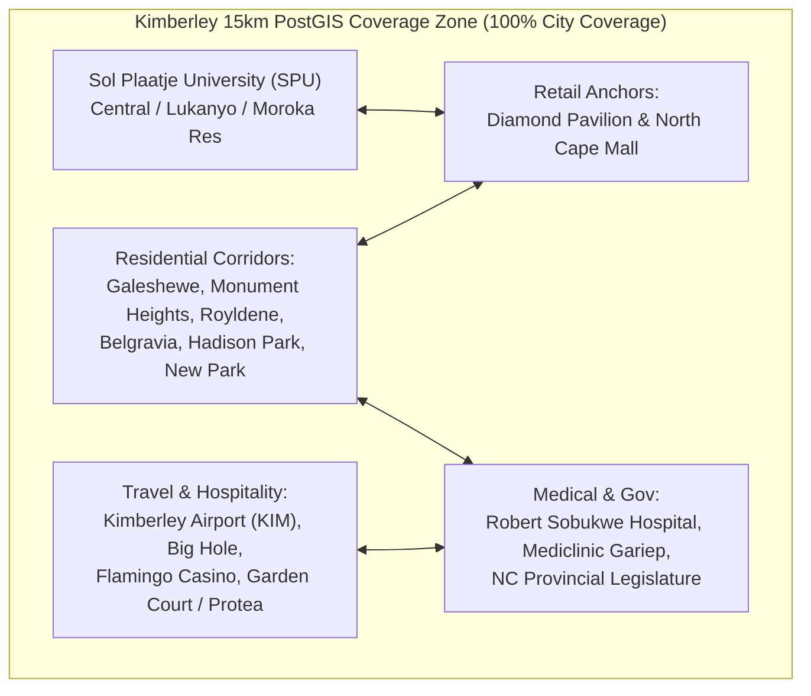

# SOLO — Kimberley (Northern Cape) Launch, Go-To-Market & Advertising Playbook
### Built for Boraine Tech (Pty) Ltd | Republic of South Africa
**Beachhead Market:** Kimberley, Northern Cape (Sol Plaatje Municipality)  
**Platform:** SOLO Zero-Commission E-Hailing (`soloride.co.za`)  
**Revenue Model:** R499/mo Driver SaaS (after 14-day free trial) | R770/mo + R499/vehicle B2B Fleet Hub ([`/fleet`](file:///c:/Users/BORAINE%20TECH/Downloads/Solo/src/app/fleet/page.tsx)) | 0.0% Trip Commission  

---

## 1. Why Kimberley is the Perfect #1 Beachhead for SOLO

Launching in **Kimberley first** gives SOLO a massive structural advantage over starting in a sprawling mega-metro:

1. **The 15km PostGIS Radius Covers the ENTIRE City:**
   - SOLO's spatial matching engine queries active drivers within a **15-kilometer radius** (`ST_DWithin(..., 15000)`).
   - From **Kimberley Airport (KIM)** in the south to **Galeshewe** in the north-west, and from **Monument Heights / Diamond Pavilion** to **Hadison Park / Carters Glen**, the entire urban footprint of Kimberley is only **10 km to 14 km across**.
   - **Result:** Every single online SOLO driver in Kimberley is visible to almost every rider in town. You never suffer from "dead suburbs."
2. **Total Market Liquidity with Just 25 to 50 Drivers:**
   - In Johannesburg or Cape Town, 40 drivers disappear on the map. In Kimberley, **30 to 50 verified drivers** gives you complete city-wide saturation, 3-to-5-minute pickup times, and instant market leadership.
3. **Kimberley's Trip & Payment Profile Matches SOLO 100%:**
   - Most Kimberley trips are **2.5 km to 7 km** (e.g., *Sol Plaatje University to Diamond Pavilion*, *Galeshewe to CBD/Hospital*, *North Cape Mall to Royldene*). On legacy apps taking 25% commission + booking fees, short-trip economics crush drivers. On SOLO, a driver keeps **100% of every R23–R48 fare** immediately.
   - Kimberley riders strongly prefer **Cash** and **Capitec / Speedpoint Tap-to-Pay** over storing credit cards in foreign apps—matching SOLO's **Direct In-Vehicle Cash & Speedpoint Settlement** model.

---

## 2. Kimberley Sample Fare Benchmark (SOLO vs. Competitors)

Use these exact Kimberley routes in your local Facebook, TikTok, and Flyer ads:

| Kimberley Route | Distance | SOLO Rider Pays (1 Rider) | Competitor / Local Cab Est. | SOLO Driver Keeps (0% Cut) | Rider Savings |
| :--- | :--- | :--- | :--- | :--- | :--- |
| **SPU Central Campus $\rightarrow$ North Cape Mall** | **2.2 km** | **R24.00** | ~R38.00 – R45.00 | **R24.00 (100%)** | **37% – 46% cheaper** |
| **SPU Campus $\rightarrow$ Diamond Pavilion Mall** | **3.8 km** | **R35.00** | ~R52.00 – R60.00 | **R35.00 (100%)** | **33% – 42% cheaper** |
| **Galeshewe (SMG) $\rightarrow$ Robert Sobukwe Hospital** | **4.5 km** | **R39.00** | ~R58.00 – R65.00 | **R39.00 (100%)** | **33% – 40% cheaper** |
| **Kimberley CBD $\rightarrow$ Flamingo Casino** | **5.2 km** | **R44.00** | ~R65.00 – R75.00 | **R44.00 (100%)** | **32% – 41% cheaper** |
| **Kimberley Airport (KIM) $\rightarrow$ Big Hole / Protea Hotel** | **7.5 km** | **R56.00** | ~R90.00 – R120.00 | **R56.00 (100%)** | **38% – 53% cheaper** |

---

## 3. Phased 90-Day Kimberley Rollout Plan

### Phase 0: Production Pre-Flight (Days -5 to 0)
1. **Deploy `soloride.co.za`:** Push Next.js 14 production build to Vercel + Supabase Pro with [`solo_supabase_hardening.sql`](file:///c:/Users/BORAINE%20TECH/Downloads/Solo/solo_supabase_hardening.sql) applied.
2. **Switch Paystack to Live:** Activate live keys for the R499/mo Driver SaaS plan and B2B Fleet Hub ([`/fleet`](file:///c:/Users/BORAINE%20TECH/Downloads/Solo/src/app/fleet/page.tsx)).
3. **Google Play Store + Direct PWA:** Submit `za.co.soloride.rider` and `za.co.soloride.driver` via [`PLAY_STORE_RELEASE.md`](file:///c:/Users/BORAINE%20TECH/Downloads/Solo/PLAY_STORE_RELEASE.md), and immediately use the built-in 1-tap PWA installer (`soloride.co.za`) for Android Chrome, Samsung Internet, and iOS.

---

### Phase 1: Kimberley Supply Lock-In — First 40 Verified Drivers & 5 Local Fleets (Days 1 to 14)
> [!IMPORTANT]
> **Rule #1: Lock in 30–40 Kimberley drivers BEFORE turning on passenger ads.**  
> Because drivers get a **14-day unrestricted free trial** and keep 100% of fares, they can leave SOLO open in the background while waiting at Diamond Pavilion or North Cape Mall with zero financial risk.

#### Where to Recruit Every E-Hailing Driver in Kimberley in 7 Days:
1. **Diamond Pavilion Mall & North Cape Mall Staging Zones:**
   - E-hailing and private cab drivers in Kimberley cluster around **Diamond Pavilion (Oliver Rd)**, **North Cape Mall (Memorial Rd)**, **Kimberley Hospital / CBD rank**, and **Kimberley Airport** before flight arrivals.
   - Walk car-to-car with printed earnings sheets. Onboard drivers on the spot via [`/driver/register`](file:///c:/Users/BORAINE%20TECH/Downloads/Solo/src/app/driver/register/page.tsx) using phone camera KYC capture ([`CameraCaptureModal.tsx`](file:///c:/Users/BORAINE%20TECH/Downloads/Solo/src/components/CameraCaptureModal.tsx)) and approve them live in [`/admin/compliance`](file:///c:/Users/BORAINE%20TECH/Downloads/Solo/src/app/admin/compliance/page.tsx).
2. **Kimberley E-Hailing WhatsApp Groups & Car Wash Hubs:**
   - Partner with popular car washes in **New Park, Royldene, and Galeshewe** where e-hailing drivers wash their sedans daily. Leave laminated driver sign-up stands and pay the car wash manager **R50 per verified driver** they refer.
3. **Local Multi-Car Fleet Owners (`/fleet`):**
   - In Kimberley, several local business owners and government employees own 2 to 6 sedans (Toyota Corolla Quest, Etios, Suzuki Dzire/Ertiga, VW Polo Vivo) rented to drivers.
   - Pitch them [`/fleet`](file:///c:/Users/BORAINE%20TECH/Downloads/Solo/src/app/fleet/page.tsx): They put their own **Yoco / iKhokha / Capitec** speedpoint in each car, collect 100% of card trips straight into their bank account, and pay a flat **R770 base + R499/car**.

---

### Phase 2: Kimberley Rider Ignition — First 1,500 Riders (Days 15 to 45)
Once 30+ verified Kimberley drivers are online:

1. **Anchor #1: Sol Plaatje University (SPU) Campus Blitz (Highest Daily Volume)**
   - SPU has thousands of students living across **Central Campus, Lukanyo, Moroka, and Taemane** residences who commute daily to **North Cape Mall**, **Diamond Pavilion**, and weekend hangout spots in **Belgravia / New Park**.
   - **Action:** Recruit **3 SPU Student Brand Ambassadors** (R1,000/mo stipend + R5 per active student signup). Distribute flyers at campus gates and post in SPU WhatsApp house/faculty groups:
     - *"SPU to North Cape Mall = R24 on SOLO. Split with 1 friend (+R4) = R14 each! Verify in 1 tap on WhatsApp (`soloride.co.za`)."*
2. **Anchor #2: The In-Car Headrest QR Trojan Horse**
   - Put 2 laminated A5 QR cards on the front-seat headrests of every Kimberley driver's car. Every passenger currently taking Bolt/InDrive/Metered Cabs in Kimberley scans the QR code in the back seat and switches to SOLO for their return trip.
3. **Anchor #3: Retail, Hospital & Shift-Worker Commuters**
   - Target nurses, doctors, and visitors at **Robert Sobukwe Hospital** and **Mediclinic Gariep**, plus retail staff knocking off after 18:00/19:00 at **Diamond Pavilion** and **North Cape Mall** (when public taxis stop running and safe, affordable door-to-door transport with a **4-digit safety PIN** is essential).
4. **Anchor #4: Kimberley Airport (KIM), Government & Corporate Travel**
   - Target business/government travelers arriving on Airlink flights at **Kimberley Airport** and staying at **Garden Court Kimberley, Protea Hotel (Big Hole), Kimberley Club, and Horseshoe Inn**.
   - Highlight that SOLO issues instant **SARS Section 11(2) compliant PDF Tax Invoices** ([`/receipt/[tripId]`](file:///c:/Users/BORAINE%20TECH/Downloads/Solo/src/app/receipt/%5BtripId%5D/page.tsx)) for government and corporate subsistence & travel (S&T) claims—even when paying by Cash or Speedpoint in the car!
   - Give hotel reception desks a sleek QR stand linking to `soloride.co.za` and [`/lost-phone`](file:///c:/Users/BORAINE%20TECH/Downloads/Solo/src/app/lost-phone/page.tsx).

---

### Phase 3: Northern Cape & Central SA Expansion (Days 46 to 90)
Once Kimberley reaches **50–80 paying drivers** (generating **R25,000 to R40,000/month** in recurring SaaS revenue), use Kimberley's cash flow to expand outward along the N8 / N12 / N14 corridors:
1. **Upington & Kuruman / Kathu (Mining & Solar Corridors, Northern Cape):** High-income mining/contractors with weak e-hailing competition.
2. **Bloemfontein (170 km east via N8):** Huge student market (UFS + CUT) where the exact same SPU student playbook scales 5x.

---

## 4. What Will It Cost to Market & Advertise in Kimberley? (ZAR Breakdown)

Marketing in Kimberley costs **60% to 70% less** than in Cape Town or Johannesburg because local digital ad auctions are far less congested, print/promoter rates are lower, and a 15km geo-fence covers the entire city population (~250,000 residents).

### A. Fixed Technical & Launch Setup Costs

| Item | Cost (ZAR) | Frequency | Purpose |
| :--- | :--- | :--- | :--- |
| **Google Play Developer Account** | ~R460 (\$25 USD) | Once-off | Publish `za.co.soloride.rider` & `za.co.soloride.driver` |
| **`soloride.co.za` Domain** | R150 – R250 | Annual | South African domain registration |
| **Supabase Pro + Vercel Pro** | ~R830 (\$45 USD) | Monthly | PostGIS database, Realtime dispatch, Next.js hosting |
| **Mapbox + WhatsApp Auth + Web Push** | **R0.00** | Monthly | Within Mapbox free tier for Kimberley volume; `wa.me` & VAPID Push are R0 |
| **Total Fixed Tech Overhead** | **~R830 / month** | **Monthly** | **Covered by your FIRST 2 paying drivers in Kimberley!** |

---

### B. Three Kimberley Marketing & Advertising Budget Tiers

#### Tier 1: Kimberley Lean / Guerrilla Launch (Bootstrap)
*Ideal for dominating Kimberley on a tight self-funded budget (Target: 35–50 Verified Drivers, 1,200–2,000 Active Kimberley Riders).*

| Marketing Channel / Line Item | Monthly Cost (ZAR) | 90-Day Total (ZAR) | Expected Deliverable / KPI |
| :--- | :--- | :--- | :--- |
| **1. In-Car Headrest QR Cards & Decals** | R800 | R2,400 | 100 laminated A5 headrest QR cards + 100 bumper/window stickers printed locally |
| **2. Driver Flyers (Diamond Pavilion / North Cape Mall)** | R600 | R1,800 | 1,000 A6 flyers handed out at mall staging zones & New Park/Galeshewe car washes |
| **3. 15km Kimberley Geo-Fenced Meta Ads (FB/IG)** | R2,000 | R6,000 | ~R65/day targeting strictly **"Kimberley + 15km"** (reaches ~45,000–60,000 locals/mo!) |
| **4. SPU Student Ambassador & Driver Referral Incentives** | R1,500 | R4,500 | R50 voucher per verified driver referred + 1 SPU student rep |
| **Tier 1 Total** | **R4,900 / month** | **R14,700 (90 Days)** | **~35–50 Drivers + ~1,500 Riders (Breaks even at 12 drivers!)** |

---

#### Tier 2: Recommended "Own Kimberley" City Takeover (Optimal ROI)
*Makes SOLO a household name across every suburb, campus, mall, and hospital in Kimberley within 60–90 days (Target: 75–100 Drivers, 6–10 Fleets, 5,000–8,000 Riders).*

| Marketing Channel / Line Item | Monthly Cost (ZAR) | 90-Day Total (ZAR) | Expected Deliverable / KPI |
| :--- | :--- | :--- | :--- |
| **1. Print Collateral & In-Vehicle QR Kits** | R2,200 | R6,600 | 200 Driver Headrest QR Kits + 3,000 SPU/Mall flyers + 30 Hotel/Guest House reception QR stands |
| **2. SPU & Mall Promoters (3 Part-Time Ambassadors)** | R3,600 | R10,800 | 3 local promoters at Sol Plaatje Uni, Diamond Pavilion & North Cape Mall on payday/weekends |
| **3. Meta Ads (Facebook & Instagram — Kimberley 15km)** | R5,500 | R16,500 | R1,500 Driver Lead Ads + R4,000 Rider Price-Beat Ads (FB Notice Boards + IG Reels) |
| **4. TikTok Local Geo-Targeted Ads (Northern Cape)** | R3,000 | R9,000 | Short local videos showing R24 SPU trips & R35 Diamond Pavilion rides |
| **5. Google Search Ads ("Taxi Kimberley" / "Uber Kimberley")** | R2,000 | R6,000 | Captures 100% of Kimberley Airport tourists, government visitors & hospital searches |
| **6. Local Media: Radio Teemaneng (89.1 FM) / DFA Digital** | R3,500 | R10,500 | Community radio live-reads on morning/afternoon drive + *Diamond Fields Advertiser* feature |
| **Tier 2 Total** | **R19,800 / month** | **R59,400 (90 Days)** | **~75–100 Drivers + ~6,000 Riders (Breaks even at 42 drivers!)** |

---

#### Tier 3: Northern Cape Regional Blitz (Kimberley + Upington / Kuruman / Bloemfontein Prep)
*Full regional saturation with commercial radio, newspaper, outdoor branding, and fleet sales reps (Target: 200+ Drivers, 20+ Fleets, 15,000+ Riders).*

| Marketing Channel / Line Item | Monthly Cost (ZAR) | 90-Day Total (ZAR) | Expected Deliverable / KPI |
| :--- | :--- | :--- | :--- |
| **1. Paid Social Dominance (Meta + TikTok + Google)** | R15,000 | R45,000 | High-frequency ad saturation across Kimberley & Northern Cape towns |
| **2. Commercial & Community Radio (OFM + Radio Teemaneng)** | R14,000 | R42,000 | Regional commercial radio spots + local Kimberley breakfast show interviews |
| **3. Dedicated Field Onboarding & Promoter Team (4 Reps)** | R10,000 | R30,000 | Daily driver KYC onboarding + campus/mall/hospital activations |
| **4. Print, Vehicle Branding, Gazebos & Venue QR Stands** | R6,000 | R18,000 | Branded SOLO gazebo for SPU/mall activations + rear-window decals for top 50 cars |
| **5. Speedpoint Co-Marketing (Subsidized Yoco/iKhokha)** | R3,000 | R9,000 | Free Yoco Go / iKhokha speedpoint for the first 10 Kimberley drivers/fleets each month |
| **Tier 3 Total** | **R48,000 / month** | **R144,000 (90 Days)** | **~200+ Drivers + ~15,000+ Riders (Breaks even at 98 drivers!)** |

---

## 5. Kimberley Unit Economics & Break-Even Math

Because Kimberley ad and activation costs are so low while the SOLO subscription remains **R499/mo per driver** (and **R770 + R499/car for fleets**), your break-even threshold in Kimberley is tiny:

| Kimberley Fleet Milestone | Monthly SaaS Revenue (ZAR) | Covers Tier 1 (R4.9k/mo + R830 tech)? | Covers Tier 2 (R19.8k/mo + R830 tech)? | Covers Tier 3 (R48k/mo + R830 tech)? | Net Monthly Profit (Under Tier 2) |
| :--- | :--- | :--- | :--- | :--- | :--- |
| **12 Paying Drivers** | **R5,988 / mo** | ✅ **YES (Break-Even!)** | ❌ No | ❌ No | -R14,642 |
| **25 Drivers + 3 Small Fleets (3 cars ea.)** | **R19,256 / mo** | ✅ **YES** | ⚠️ Nearly (93%) | ❌ No | -R1,374 |
| **42 Paying Drivers** (or 30 Drivers + 3 Fleets) | **R20,958 / mo** | ✅ **YES** | ✅ **YES (Break-Even!)** | ❌ No | **+R328 / mo** |
| **75 Drivers + 6 Fleets (4 cars ea.)** | **R54,021 / mo** | ✅ **YES** | ✅ **YES** | ✅ **YES (Break-Even!)** | **+R33,391 / mo** |
| **120 Drivers + 10 Fleets (4 cars ea.)** | **R87,540 / mo** | ✅ **YES** | ✅ **YES** | ✅ **YES** | **+R66,910 / mo** |

> [!TIP]
> **Look at how achievable this is in Kimberley:**  
> - **12 paying drivers** covers your entire **Tier 1 Kimberley Launch Budget + Production Server Hosting**.  
> - **42 paying drivers** covers the entire **Tier 2 "Own Kimberley" Budget (R19,800/mo)**.  
> - At **75 drivers + 6 local fleet partners**, SOLO is netting over **R33,000/month in pure profit** from Kimberley alone—giving you a self-funding war chest to launch Bloemfontein or Cape Town next.

---

## 6. Ready-to-Use Kimberley Marketing Copy & Scripts

### 1. Kimberley Driver WhatsApp & Facebook Group Broadcast
*(Post in Kimberley Notice Board, Kimberley Bulletin, Northern Cape E-Hailing & Metered Taxi WhatsApp groups)*
> **🚨 KIMBERLEY E-HAILING & CAB DRIVERS: STOP GIVING AWAY 25% OF YOUR FARES! 🚨**  
>   
> With fuel prices up and most Kimberley trips between R30 and R60, why let overseas apps take **25% to 30% commission** out of every single ride—and make you wait until next week for your own money?  
>   
> **SOLO (`soloride.co.za`) is launching right here in KIMBERLEY:**  
> ✅ **0.0% Commission:** A passenger pays R45 from Diamond Pavilion to Galeshewe? **You keep the full R45.00.**  
> ✅ **Paid Immediately in Your Car:** Collect **Cash** or tap the passenger's card on **YOUR own Speedpoint** (Capitec, Yoco, iKhokha, Nedbank PocketPOS). Zero platform escrow delays!  
> ✅ **First 14 Days 100% FREE:** Then just a flat **R499/month**—keep every extra Rand you earn above that.  
> ✅ **Built-in Kimberley Safety:** Mandatory 4-digit passenger boarding PIN + 1-tap SAPS `10111` / `112` SOS + single-device protection.  
>   
> 👉 **Register as a Founding Kimberley Driver in 3 minutes:** `https://soloride.co.za/driver/register`  
> 🚗 **Own 2 or more cars in Kimberley?** Run your shifts on the SOLO Fleet Hub: `https://soloride.co.za/fleet`

---

### 2. Kimberley Rider Facebook / TikTok / SPU Campus Ad Copy
> **💎 KIMBERLEY! WHY PAY R55+ FOR A RIDE WHEN IT'S R24–R35 ON SOLO? 💎**  
>   
> Going from **SPU to North Cape Mall**? **R24.**  
> **Galeshewe to Robert Sobukwe Hospital**? **R39.**  
> **Diamond Pavilion to Monument Heights / Royldene**? **R25.**  
>   
> Because **SOLO (`soloride.co.za`)** charges Kimberley drivers **0% commission**, your local driver earns MORE while you pay **20% to 45% LESS** on every trip!  
>   
> 💳 **Pay Your Way in the Car:** Cash or Card Machine (Tap your Capitec/FNB/Standard Bank card or phone).  
> 🔐 **Safe Every Trip:** Verified PrDP drivers + mandatory 4-digit Safety PIN before the car moves.  
> ⚡ **No App Store Storage Needed:** Tap `https://soloride.co.za` — installs in 5 seconds & verifies with 1 tap on WhatsApp!

---

### 3. Press Release Pitch to *Diamond Fields Advertiser (DFA)*, *OFM News* & *Radio Teemaneng 89.1 FM*
> **Subject:** Media Release: South African Tech Company Chooses Kimberley as Launch City for "SOLO" — A 0% Commission Ride-Hailing Platform  
>   
> **Story Angle for Local Kimberley Media:**  
> Instead of launching in Johannesburg or Cape Town first, South African technology firm **Boraine Tech (Pty) Ltd** (founded by **Allan Boraine**) has selected **Kimberley, Northern Cape** as the official national launchpad for **SOLO (`soloride.co.za`)**.  
>   
> While foreign e-hailing apps extract up to 30% of every fare out of the local Kimberley economy, SOLO charges **0.0% commission**—allowing Kimberley drivers and fleet owners to keep 100% of every fare paid directly in the vehicle via cash or local speedpoints (Yoco, iKhokha, Capitec POS). For Kimberley residents, SPU students, and hospital commuters, eliminating the middleman commission cuts ride prices by **20% to 45%** while enforcing strict NLTA PrDP compliance and a mandatory 4-digit boarding safety PIN.

*(Local pride is huge in the Northern Cape—pitching **"Kimberley chosen first in South Africa ahead of JHB and CPT"** guarantees free newspaper coverage in the DFA and free interviews on Radio Teemaneng 89.1 FM and OFM!)*

---

## 7. First 7-Day Kimberley Execution Checklist

- [ ] **Day 1 (Tech Go-Live):** Point `soloride.co.za` to production, run [`solo_supabase_hardening.sql`](file:///c:/Users/BORAINE%20TECH/Downloads/Solo/solo_supabase_hardening.sql), and switch Paystack to live mode.
- [ ] **Day 2 (Print Collateral):** Print **100 laminated A5 Headrest QR Cards** and **1,000 A6 Kimberley Driver Flyers** (~R1,400 total).
- [ ] **Day 3–4 (Driver Onboarding Sweep):** Visit **Diamond Pavilion Mall**, **North Cape Mall**, **Kimberley Airport**, and top **New Park / Galeshewe car washes**. Sign up and verify your first **25–35 Kimberley drivers** on [`/driver/register`](file:///c:/Users/BORAINE%20TECH/Downloads/Solo/src/app/driver/register/page.tsx) and approve their docs in [`/admin/compliance`](file:///c:/Users/BORAINE%20TECH/Downloads/Solo/src/app/admin/compliance/page.tsx).
- [ ] **Day 5 (Fleet & Hotel Partners):** Sign up **3 local multi-car owners** on [`/fleet`](file:///c:/Users/BORAINE%20TECH/Downloads/Solo/src/app/fleet/page.tsx) and place QR reception stands at **Garden Court, Protea Hotel Big Hole, and Kimberley Airport shuttle desks**.
- [ ] **Day 6 (SPU & Community Launch):** Deploy flyers at **Sol Plaatje University** gates and post in *Kimberley Bulletin* & *Kimberley Notice Board* Facebook groups.
- [ ] **Day 7 (Media & Paid Ads):** Send the **"Kimberley Chosen First in SA"** press release to the *Diamond Fields Advertiser (DFA)* and *Radio Teemaneng 89.1 FM*, and switch on a **R65–R150/day Meta & TikTok ad campaign** geo-fenced strictly to **Kimberley + 15km**.
